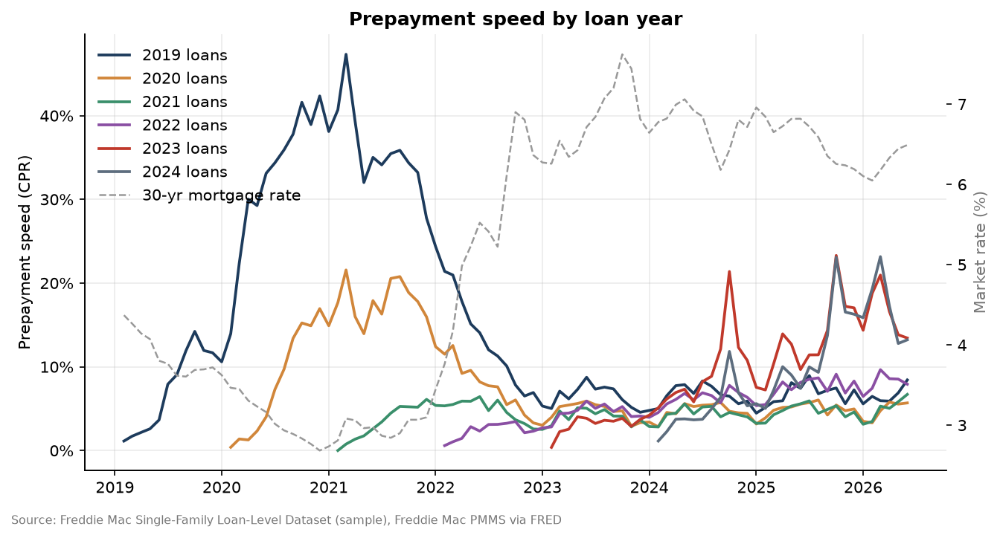
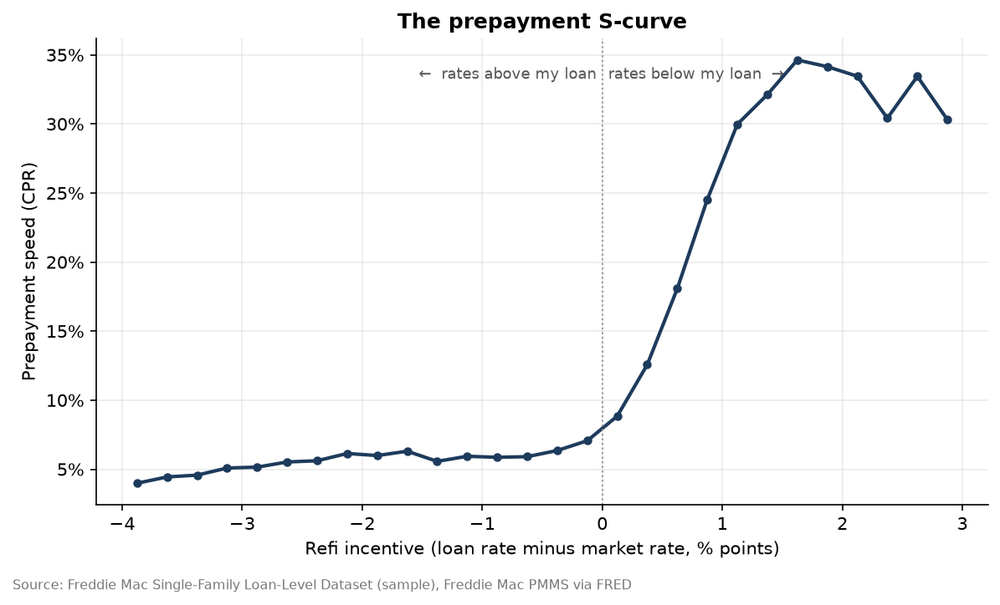
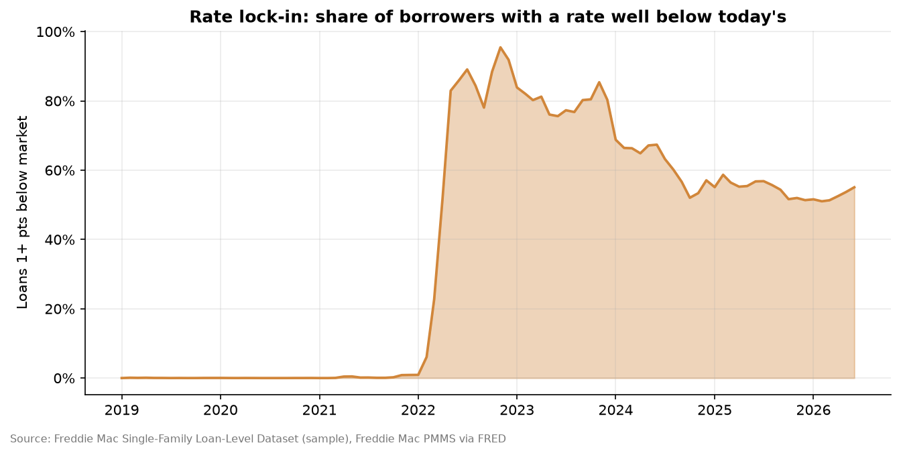
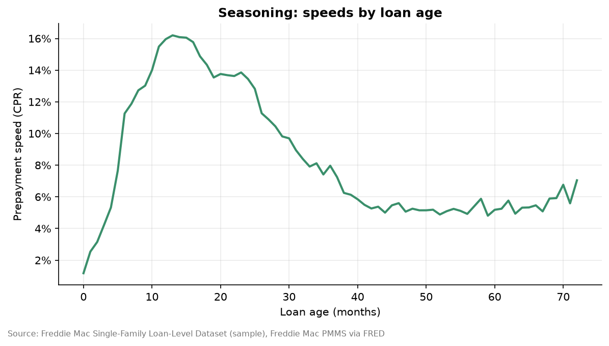

# Mortgage Prepayment Analysis

**How do interest rates change how fast people pay off their mortgages?**

When mortgage rates drop, homeowners refinance and pay off their old loans early. When rates rise, they hold on to their cheap loans and stay put. How fast this happens (the "prepayment speed") is one of the biggest drivers of mortgage-backed securities (MBS) prices, because it decides when investors get their money back.

This project uses Freddie Mac's public loan-level data to measure prepayment speeds across different loan years and rate environments, and to show three well-known patterns in the real data:

1. **The S-curve.** Prepayments stay low until a borrower can save real money by refinancing, then jump sharply.
2. **Rate lock-in.** After rates shot up in 2022, most borrowers were sitting on rates far below the market, and prepayments slowed way down.
3. **Seasoning.** Brand new loans prepay slowly, and speeds ramp up as loans age.

## Key findings

Based on 300,000 Freddie Mac loans made from 2019 to 2024, tracked through June 2026.

- **Rates drive almost everything.** Borrowers whose rate was 1+ point above the market paid off at a **31.9% CPR**, over **6x faster** than borrowers 1+ point below the market (**5.0%**).
- **The 2020 to 2021 refi wave was huge.** When rates fell below 3%, loans made in 2019 (avg rate 4.24%) peaked at a **47% CPR** in March 2021, meaning almost half the remaining loans were on pace to pay off within a year.
- **Rate lock-in is real.** After rates jumped in 2022, **95%** of outstanding loans in the sample had a rate at least 1 point below the market (Nov 2022). As of June 2026 it's still **55%**.
- **The cheapest loans barely move.** 2021 loans (avg rate 2.97%) have prepaid at just **4.5% CPR** over their life. With almost no way to refinance lower, those payoffs are likely mostly home sales.
- **Newer, pricier loans are now the fast ones.** 2023 and 2024 loans (avg rate about 6.7%) ran at about **16% CPR** over the last 12 months, and jumped to around **23%** when rates dipped toward 6%.

*Note: the seasoning chart mixes loan age with timing (many young loans in this sample were young during the 2020 refi boom), so treat it as a rough picture.*

## Charts

| | |
|---|---|
|  |  |
|  |  |

## Key terms

- **CPR (conditional prepayment rate):** the share of the remaining loans that pay off in a year, annualized from monthly payoffs. 10% CPR means about 10% of the loans would pay off over a year at the current pace.
- **Refi incentive:** the loan's rate minus today's market rate. If your loan is at 7% and rates are 6%, your incentive is +1 point, so refinancing saves you money.
- **Vintage / loan year:** the year the loans were made.

## Data

- **Loans:** [Freddie Mac Single-Family Loan-Level Dataset](https://www.freddiemac.com/research/datasets/sf-loanlevel-dataset), sample files (about 50,000 loans per year, with monthly payment history).
- **Market rate:** Freddie Mac's weekly 30-year mortgage rate survey (PMMS), via [FRED series MORTGAGE30US](https://fred.stlouisfed.org/series/MORTGAGE30US).

The raw data isn't stored in this repo. See [data/README.md](data/README.md) for how to download it.

## How to run it

```bash
pip install -r requirements.txt

# 1. Download the data into data/raw/ (see data/README.md)
# 2. Run the analysis
python run_analysis.py

# Or pick specific loan years
python run_analysis.py --years 2019 2021 2023
```

Charts, CSV tables, and a `summary.md` with the headline numbers are saved to `outputs/`.

**Want to test it before downloading anything?** Generate fake data and run on that:

```bash
python scripts/make_synthetic_data.py
python run_analysis.py --synthetic      # writes to outputs_synthetic/
```

Run the tests with `pytest`.

## Method

1. Load each loan's origination record and monthly payment history.
2. A loan counts as prepaid in the month Freddie Mac reports it paid off in full (zero balance code `01`).
3. **SMM** = payoffs / loans outstanding that month. **CPR** = 1 - (1 - SMM)^12.
4. **Refi incentive** = the loan's rate minus the average 30-year market rate from the month before (refinances take a few weeks to close).
5. Group by loan year, month, incentive bucket (0.25 point wide), and loan age.

**Limitations**

- Only full payoffs are counted, not partial extra payments, so these CPRs run a bit lower than official agency numbers.
- Payoffs include both refinances and home sales. The data doesn't say which is which.
- The sample files are a random slice of Freddie Mac loans, not the full dataset.

## Project structure

```
run_analysis.py              run everything
src/prepay/
    load.py                  read Freddie Mac sample files (.txt or .zip)
    rates.py                 read the FRED mortgage rate CSV
    metrics.py               SMM, CPR, refi incentive, S-curve, lock-in, seasoning
    plots.py                 charts
    report.py                headline numbers and summary.md
scripts/make_synthetic_data.py   fake data for testing
tests/                       unit tests for the math
data/README.md               how to get the data
outputs/                     charts, tables, summary
```

## Ideas for next steps

- Split results by credit score, loan size, or state
- Add partial prepayments using month-to-month balance changes
- Fit a simple prepayment model (logistic regression or gradient boosting) on incentive, loan age, and borrower features
- Build an interactive dashboard in Power BI or Streamlit
